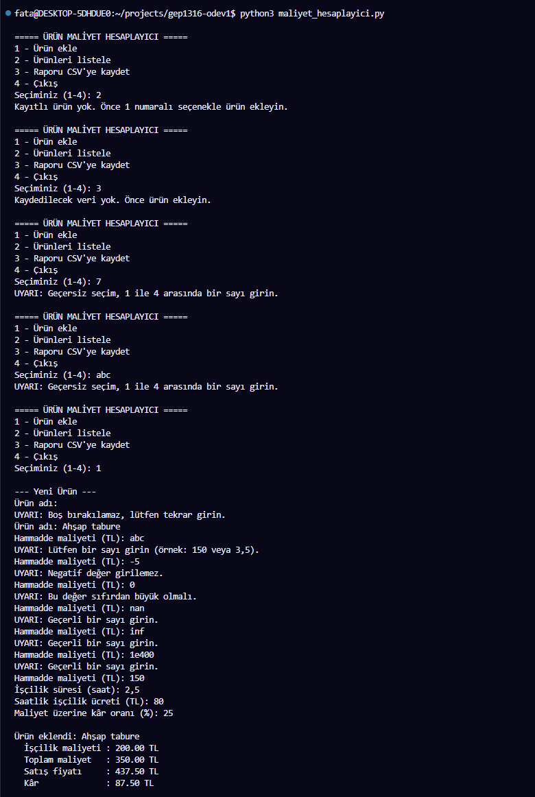
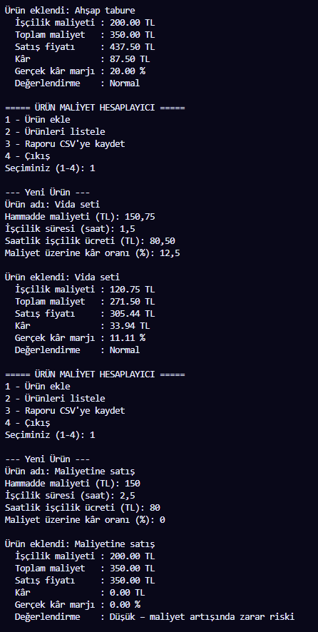
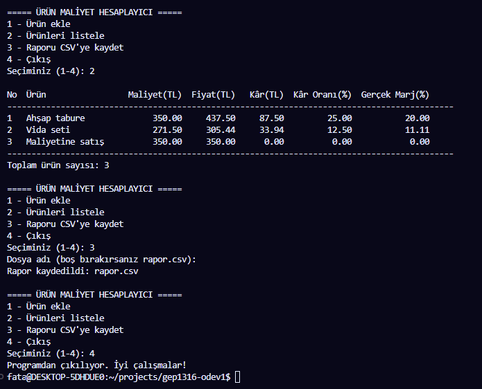
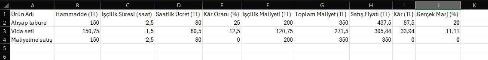
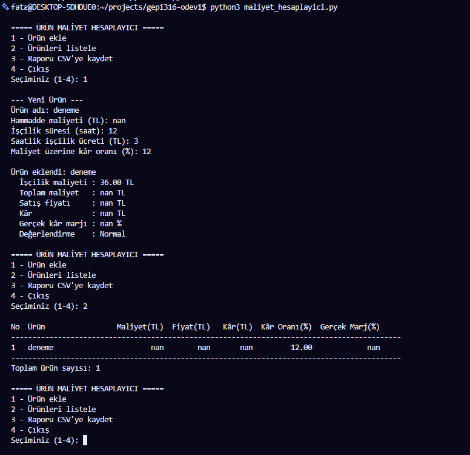
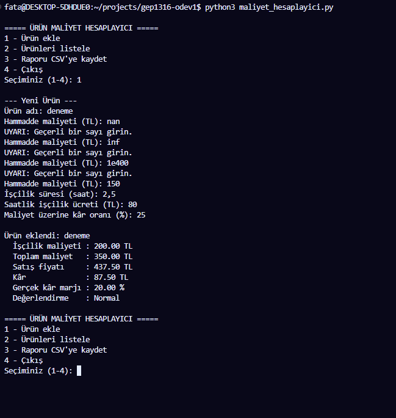

# Ürün Maliyet ve Satış Fiyatı Hesaplayıcı

Küçük üretim atölyeleri için yazılmış, komut satırında çalışan bir Python
programı. Atölye sahibi ürünün hammadde maliyetini, işçilik süresini, saatlik
işçilik ücretini ve uygulamak istediği kâr oranını girer; program toplam
maliyeti ve satış fiyatını hesaplar. Böylece fiyatlar elde kâğıt üzerinde veya
tahminle değil, aynı formülle ve tutarlı biçimde belirlenir; sonuçlar Excel'de
açılabilen bir CSV raporuna aktarılabilir.

**Ders:** GEP1316 Kodlama Okuryazarlığı – Öğr. Gör. Adem ÖZER – 2026-2027 Güz

## Özellikler

- Her ürün için işçilik maliyeti, toplam maliyet, satış fiyatı, kâr (TL) ve
  gerçek kâr marjını (%) hesaplar.
- Girilen kâr oranını değerlendirir: %10 altı "Düşük – maliyet artışında zarar
  riski", %10-40 "Normal", %40 üstü "Yüksek – rekabet açısından kontrol edin".
- Hatalı girdide çökmez: harf, negatif sayı, sıfır, `nan`/`inf` ve boş ürün adı
  reddedilir, uyarı verilip soru tekrar sorulur.
- Ondalık sayılar virgülle de girilebilir (`2,5`).
- Raporu Türkçe Excel'in doğrudan açabildiği CSV biçiminde kaydeder
  (`utf-8-sig`, `;` ayırıcı, `437,50` biçiminde sayılar).

## Kâr oranı ve gerçek kâr marjı farkı

Program maliyetin **üzerine** kâr oranı ekler (markup); satış fiyatı üzerinden
hesaplanan gerçek kâr marjı bundan düşüktür:

> 350,00 TL maliyetli bir ürüne **%25 kâr oranı** uygulanırsa satış fiyatı
> 437,50 TL, kâr 87,50 TL olur. Gerçek kâr marjı ise
> 87,50 / 437,50 = **%20**'dir.

Bu yüzden listede ve CSV raporunda iki değer ayrı sütunlarda gösterilir.

## Gereksinimler ve çalıştırma

- Python 3 (yalnızca standart kütüphane kullanılır, ek kurulum gerekmez)

```bash
python3 maliyet_hesaplayici.py
```

## Kullanım

Program açılınca menü gelir:

1. **Ürün ekle** – sırasıyla ürün adı, hammadde maliyeti (TL), işçilik süresi
   (saat), saatlik işçilik ücreti (TL) ve maliyet üzerine kâr oranı (%) sorulur;
   ürün eklenince özet ve kâr oranı değerlendirmesi ekrana yazılır.
2. **Ürünleri listele** – eklenen ürünler tablo hâlinde gösterilir.
3. **Raporu CSV'ye kaydet** – dosya adı sorulur (boş bırakılırsa `rapor.csv`).
4. **Çıkış** – programdan çıkar.

## Ekran görüntüleri

**Menü, boş liste uyarıları, geçersiz menü seçimi ve hatalı girdi kontrolleri**



**Ürün ekleme ve hesap sonuçları (normal, virgüllü girdi ve %0 kâr oranı)**



**Ürün listesi, CSV'ye kaydetme ve çıkış**



**Oluşan raporun Excel'de görünümü**



## Bulunan hata ve düzeltmesi

Test sırasında hammadde maliyetine `nan` girilebildiği görüldü: `float("nan")`
hata vermeden çevrildiği ve `nan < 0` karşılaştırması her zaman yanlış olduğu
için değer kontrollerden geçiyor, maliyet ve fiyat `nan` çıkıyordu.



Düzeltme olarak `sayi_al()` fonksiyonuna, negatiflik kontrolünden önce
`math.isfinite()` kontrolü eklendi; `nan`, `inf` ve `1e400` gibi girdiler artık
reddediliyor.



## Dosya yapısı

| Dosya | Açıklama |
|---|---|
| [maliyet_hesaplayici.py](maliyet_hesaplayici.py) | Programın tamamı (menü, hesaplamalar, girdi kontrolü, CSV kaydı) |
| [TASARIM.md](TASARIM.md) | Sözde kod, akış şeması, fonksiyon listesi ve veri yapısı |
| [TESTLER.md](TESTLER.md) | 10 senaryoluk test tablosu ve sonuçları |
| [PROMPTLAR.md](PROMPTLAR.md) | Yapay zekâ ile çalışma günlüğü (kullanılan promptlar) |
| [rapor.csv](rapor.csv) | Program tarafından üretilen örnek CSV raporu |
| [ekran_goruntuleri/](ekran_goruntuleri/) | Test ve hata düzeltmesi ekran görüntüleri |

## Yapay zekâ kullanımı

Ödevin tasarımı, kodu ve belgeleri yapay zekâ desteğiyle hazırlanmıştır.
Kullanılan promptlar [PROMPTLAR.md](PROMPTLAR.md) dosyasında kayıtlıdır;
üretilen kod çalıştırılarak test edilmiş ve bulunan hata düzeltilmiştir.

Anthropic. (2026). *Claude* [Büyük dil modeli]. https://claude.ai
