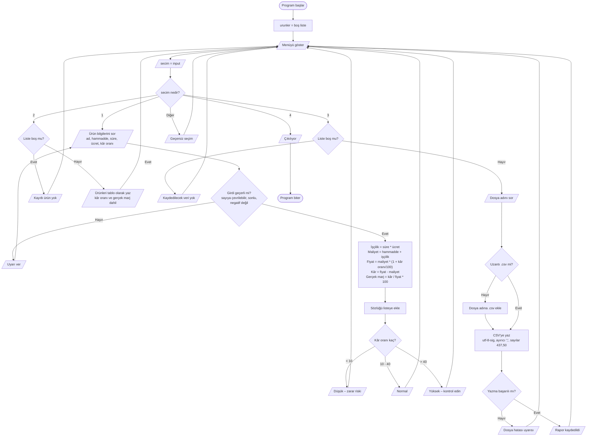

# GEP1316 – Ürün Maliyet ve Satış Fiyatı Hesaplayıcı – Tasarım

Bu dosya `maliyet_hesaplayici.py` programının tasarımını içerir:
sözde kod, akış şeması, fonksiyon listesi ve veri yapısı.

## Hesaplama formülleri

```
işçilik maliyeti = işçilik süresi (saat) * saatlik ücret (TL)
toplam maliyet   = hammadde maliyeti + işçilik maliyeti
satış fiyatı     = toplam maliyet * (1 + kâr oranı / 100)
kâr              = satış fiyatı - toplam maliyet
gerçek kâr marjı = kâr / satış fiyatı * 100
```

**Önemli kavram ayrımı:** Kullanıcıdan alınan değer *maliyet üzerine kâr oranı*
(markup) olup satış fiyatı üzerinden hesaplanan *gerçek kâr marjı* ile aynı şey
değildir. Örnek: %25 kâr oranı girildiğinde gerçek marj %20'dir
(87,50 / 437,50 = %20). Bu yüzden ikisi ayrı ayrı gösterilir.

## 1. Sözde kod (pseudocode)

```
PROGRAM urun_maliyet_hesaplayici

  BAŞLANGIÇ
    urunler = boş liste          # tüm ürünler burada tutulur

    WHILE DOĞRU:                             # çıkış seçilene kadar döner
        menüyü ekrana yaz
        secim = kullanıcıdan metin al

        IF secim = "1":                          # ürün ekle
            ad = boş olmayan metin al
            hammadde = sıfırdan büyük sayı al    # TL
            sure = sıfırdan büyük sayı al        # saat
            ucret = sıfırdan büyük sayı al       # TL/saat
            kar_orani = 0 veya daha büyük sayı al # maliyet üzerine kâr oranı (%)

            iscilik = sure * ucret
            toplam = hammadde + iscilik
            fiyat = toplam * (1 + kar_orani / 100)
            kar = fiyat - toplam
            gercek_marj = kar / fiyat * 100

            urun = sözlük oluştur(ad, hammadde, sure, ucret, kar_orani,
                                  iscilik, toplam, fiyat, kar, gercek_marj)
            urun'ü urunler listesine ekle

            "Ürün eklendi" özetini yaz (maliyet, fiyat, kâr, gerçek marj)
            degerlendirme = kar_orani_degerlendir(kar_orani)
            degerlendirme mesajını yaz

        ELSE IF secim = "2":                     # listele
            IF urunler boş:
                "Kayıtlı ürün yok" yaz
            ELSE:
                tablo başlığını yaz
                FOR her urun IN urunler:
                    ad, toplam maliyet, satış fiyatı, kâr,
                    kâr oranı ve gerçek marj bilgilerini yaz
                toplam ürün sayısını yaz

        ELSE IF secim = "3":                     # CSV'ye kaydet
            IF urunler boş:
                "Kaydedilecek veri yok" yaz
            ELSE:
                dosya_adi = kullanıcıdan al (boş ise "rapor.csv")
                IF dosya_adi ".csv" ile bitmiyor:
                    dosya_adi = dosya_adi + ".csv"
                TRY:
                    WITH dosyayı yazma modunda aç (encoding = utf-8-sig):
                        ayırıcısı ";" olan CSV yazıcı oluştur
                        başlık satırını yaz
                        FOR her urun IN urunler:
                            sayıları "2 ondalık, ondalık ayırıcı virgül" biçimine çevir
                            satırı yaz
                    # WITH bloğu bitince dosya otomatik kapanır
                    "Rapor kaydedildi" yaz
                EXCEPT dosya hatası (OSError):
                    "Dosya yazılamadı" uyarısı yaz

        ELSE IF secim = "4":                     # çıkış
            "Programdan çıkılıyor" yaz
            BREAK                            # döngüden çıkılır, program biter

        ELSE:
            "Geçersiz seçim, 1-4 arası girin" uyarısı yaz
  BİTİŞ
```

Sayı alma alt-rutini (hatalı girdide çökmeyi önleyen kısım):

```
FONKSİYON sayi_al(mesaj, sifir_olabilir):
    WHILE DOĞRU:                     # doğru değer gelene kadar sonsuz döngü
        girdi = input(mesaj)
        girdi'deki boşlukları sil, virgülü noktaya çevir   # 3,5 -> 3.5
        TRY:
            sayi = float(girdi)
        EXCEPT ValueError:
            "Lütfen bir sayı girin" uyarısı yaz
            CONTINUE                 # baştan sor
        IF sayi sonlu değil:         # "nan", "inf", "1e400" -> math.isfinite
            "Geçerli bir sayı girin" uyarısı yaz
            CONTINUE                 # bu kontrol negatiflik testinden ÖNCE olmalı,
                                     # çünkü nan < 0 karşılaştırması her zaman YANLIŞ'tır
        IF sayi < 0:
            "Negatif değer girilemez" uyarısı yaz
            CONTINUE
        IF sayi = 0 VE sifir_olabilir = YANLIŞ:
            "Bu değer sıfırdan büyük olmalı" uyarısı yaz
            CONTINUE
        RETURN sayi                  # geçerli değer, döngüden çık
```

Kâr oranı değerlendirme alt-rutini:

```
FONKSİYON kar_orani_degerlendir(kar_orani):
    IF kar_orani < 10:
        RETURN "Düşük – maliyet artışında zarar riski"
    ELSE IF kar_orani <= 40:
        RETURN "Normal"
    ELSE:
        RETURN "Yüksek – rekabet açısından kontrol edin"
```

## 2. Akış şeması (Mermaid)



## 3. Fonksiyon listesi

| Fonksiyon | Parametreler | Döndürür | Görevi |
|---|---|---|---|
| `menu_goster()` | — | `None` | Menü seçeneklerini ekrana yazar |
| `metin_al(mesaj)` | `mesaj: str` | `str` | Boş olmayan metin alana kadar sorar (ürün adı için) |
| `sayi_al(mesaj, sifir_olabilir)` | `mesaj: str`, `sifir_olabilir: bool` | `float` | Geçerli, sonlu ve negatif olmayan sayı alana kadar sorar; virgüllü girdiyi kabul eder, `try/except ValueError` ile çökmeyi önler, `math.isfinite()` ile `nan`/`inf` değerleri reddeder |
| `iscilik_maliyeti_hesapla(sure, saatlik_ucret)` | `float, float` | `float` | `sure * saatlik_ucret` |
| `toplam_maliyet_hesapla(hammadde, iscilik)` | `float, float` | `float` | `hammadde + iscilik` |
| `satis_fiyati_hesapla(toplam_maliyet, kar_orani)` | `float, float` | `float` | `toplam_maliyet * (1 + kar_orani / 100)` |
| `gercek_marj_hesapla(kar, satis_fiyati)` | `float, float` | `float` | `kar / satis_fiyati * 100` (sıfıra bölmeye karşı korumalı) |
| `kar_orani_degerlendir(kar_orani)` | `float` | `str` | `if/elif/else` ile kâr oranı yorumunu üretir |
| `sayi_bicimle(sayi)` | `float` | `str` | Sayıyı CSV için `437,50` biçimine çevirir |
| `urun_bilgisi_al()` | — | `dict` | Beş girdiyi sorar, hesaplamaları yapar, dolu ürün sözlüğü döndürür |
| `urun_ekle(urunler)` | `urunler: list` | `None` | Ürünü listeye ekler, özeti ve değerlendirmeyi yazar |
| `urunleri_listele(urunler)` | `urunler: list` | `None` | Listeyi hizalı tablo olarak yazdırır; liste boşsa uyarır |
| `csv_kaydet(urunler, dosya_adi)` | `list, str` | `bool` | `csv` modülüyle raporu dosyaya yazar, `OSError` yakalar |
| `main()` | — | `None` | Listeyi oluşturur, menü döngüsünü çalıştırır, seçimleri yönlendirir |

## 4. Veri yapısı

Ana depo **sözlüklerden oluşan bir liste**. Program çalıştığı sürece bellekte
durur; kalıcı kayıt yalnızca CSV'ye yazılır.

```python
# Tek bir ürün = sözlük (dictionary)
urun = {
    "ad": "Ahşap tabure",    # str   - ürün adı                        [girdi]
    "hammadde": 150.0,       # float - hammadde maliyeti (TL)          [girdi]
    "sure": 2.5,             # float - işçilik süresi (saat)           [girdi]
    "ucret": 80.0,           # float - saatlik ücret (TL/saat)         [girdi]
    "kar_orani": 25.0,       # float - maliyet üzerine kâr oranı (%)   [girdi]
    "iscilik": 200.0,        # float - hesaplanan: sure * ucret
    "toplam_maliyet": 350.0, # float - hesaplanan: hammadde + iscilik
    "satis_fiyati": 437.5,   # float - hesaplanan: maliyet * 1.25
    "kar": 87.5,             # float - hesaplanan: fiyat - maliyet
    "gercek_marj": 20.0,     # float - hesaplanan: kar / fiyat * 100
}

# Tüm ürünler = liste
urunler = [urun1, urun2, urun3]   # sırayla, index ile erişilir
```

Tasarım kararları:

- **Sözlük, çünkü** alanlara `urun["satis_fiyati"]` gibi isimle erişmek
  `urun[7]` demekten çok daha okunabilir.
- **Hesaplanan değerler de sözlükte saklanıyor**; listelemede ve CSV'de tekrar
  hesaplanmasın diye (tek kaynak, tutarlı sonuç).
- **Para birimi ayrı alanda tutulmuyor**; her şey TL kabul edilir. Ekranda
  `f"{deger:.2f} TL"` ile yazdırılır.
- **CSV sütun sırası** sözlük anahtarlarıyla birebir aynıdır:
  `ad, hammadde, sure, ucret, kar_orani, iscilik, toplam_maliyet,
  satis_fiyati, kar, gercek_marj`.
- **CSV biçimi:** `encoding="utf-8-sig"` (Excel Türkçe karakterleri doğru
  okur), `delimiter=";"` ve sayılar iki ondalıklı, ondalık ayırıcı virgül
  (`437,50`) – Türkçe Excel bu değerleri sayı olarak tanır.
